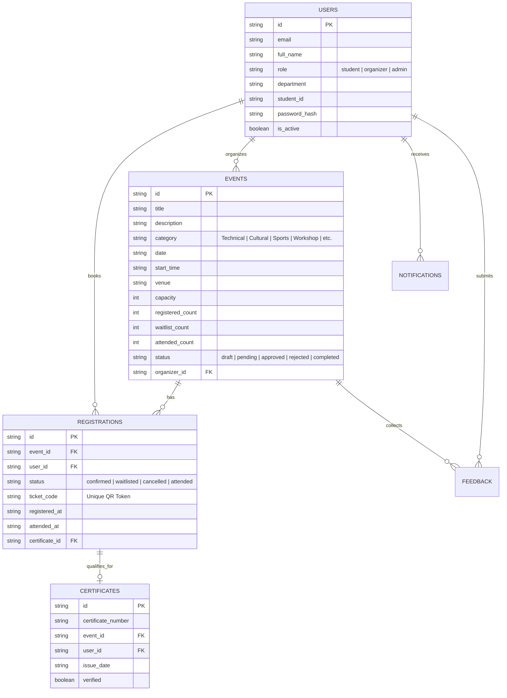

# 🎓 NexEvent — Smart College Event Management System

An enterprise-grade, full-stack event discovery, registration, and attendance management platform tailored for university campuses. Designed with clean role-based architecture, real-time QR check-in scanning, automated waitlists, AI event drafting, verified PDF certificates, and platform analytics.

Built for academic viva evaluation, technical demonstrations, and real-world college deployment.

---

## 🌟 Key Features

### 👨‍🎓 1. Student Portal
- **Browse & Filter Events:** Discover hackathons, workshops, cultural festivals, and sports competitions by category, date, venue, and seat availability.
- **Explainable Smart Recommendations:** Recommends events tailored to individual interests and student departmental profiles.
- **One-Click Registration & Waitlist Automation:** Instant booking with capacity validation and automatic promotion when existing attendees cancel.
- **Dynamic QR Access Pass:** Generates a unique, tamper-evident QR ticket code viewable directly on mobile or desktop.
- **Calendar Integration:** One-click download of `.ics` calendar invites for Apple Calendar, Google Calendar, and Outlook.
- **Verified PDF Certificates:** Automatic unlocking of official participation certificates upon organizer attendance verification.
- **Event Reviews & Ratings:** Star ratings and reviews for completed events with duplicate prevention.

### 🧑‍💼 2. Event Organizer Studio
- **AI Event Assistant:** Built-in generative helper to auto-draft titles, descriptions, prerequisites, and tags from a short theme or prompt.
- **Event Lifecycle Management:** Submit events for administrative review with venue, schedule, poster URL, and seat capacity controls.
- **Live QR Ticket Scanner:** Live camera/manual QR scanner to verify tickets at the venue door, prevent duplicate scans, and log timestamps.
- **Live Attendee Roster:** Real-time visibility into registered, waitlisted, and attended participants.

### 🛡️ 3. Administrative Console
- **Platform Analytics Dashboard:** Real-time metrics including total events, student enrollment, attendance rates, category distribution (Recharts Pie), and event capacity utilization (Recharts Bar).
- **Approval Workflow Queue:** Review pending events submitted by campus clubs and professors with instant Approve or Reject-with-Reason actions.
- **User Role & Governance Management:** Promote users between Student, Organizer, and Admin roles; suspend or reactivate accounts.
- **Tamper-Evident Audit Logs:** Complete chronological trail recording every significant system action (approvals, logins, cancellations, scans).
- **Report Export:** Instant CSV export of events and attendee participation data.

---

## 🎨 Design System & Visual Identity

Engineered strictly adhering to the specified university product visual guidelines:
- **Primary Accent:** `#F97316` (Warm Orange)
- **Dark Accent:** `#EA580C` (Deep Amber-Orange)
- **Main Background:** `#FFFFFF`
- **Soft Surface:** `#FFF7ED`
- **Border:** `#FFEDD5`
- **Main Text:** `#0F172A` (Slate 900)
- **Muted Text:** Neutral Slate (`#64748B`)
- **Typography:** Plus Jakarta Sans & Inter typography scale

---

## 🏗️ Architecture & Technology Stack

| Layer | Technologies |
|---|---|
| **Frontend** | React 18, Vite 6, Tailwind CSS, Lucide React, Recharts |
| **Backend** | Python 3.13, FastAPI, Pydantic v2, Uvicorn, Jose JWT, Passlib (Bcrypt) |
| **Database & Persistence** | Dual-mode: Atomic thread-safe JSON persistence (zero-setup offline demo mode) + Firebase Firestore integration |
| **Ticketing & QR** | `qrcode` (Python), `qrcode.react`, and `html5-qrcode` |
| **PDF Generation** | ReportLab (tamper-resistant vector certificate rendering) |

---

## ⚡ Quick Start & Run Instructions

### Prerequisites
- Node.js (v18+)
- Python (3.10+)

### 1. Launch with One Command (Recommended)
```bash
./start.sh
```
This automatically initializes Python venv, starts FastAPI on `http://127.0.0.1:8000`, and launches the Vite React frontend on `http://localhost:5173`.

### 2. Manual Startup

**Backend:**
```bash
python3 -m venv backend/venv
source backend/venv/bin/activate
pip install -r backend/requirements.txt
uvicorn backend.main:app --reload --port 8000
```

**Frontend:**
```bash
cd frontend
npm install
npm run dev
```

Visit the frontend at **http://localhost:5173** and the FastAPI Swagger docs at **http://127.0.0.1:8000/docs**.

---

## 🔑 Pre-Seeded Demo Accounts (Instant Viva Demonstration)

The application includes realistic campus data and one-click demo logins on the Login page and Navbar:

| Role | Email | Password | Pre-loaded Context |
|---|---|---|---|
| **Student** | `student@campus.edu` | `student123` | Has active tickets (HackCampus 2026), waitlisted events, and completed cricket tournament certificate |
| **Organizer** | `organizer@campus.edu` | `organizer123` | Owns HackCampus, Cultural Fiesta, and CS Lab Workshop; can scan QR tickets and draft events |
| **Administrator**| `admin@campus.edu` | `admin123` | Full access to approval queue, user roles, metrics charts, and audit trail |

---

## 📊 Database Schema



---

## 🔒 Security & Concurrency Controls

1. **Role-Based Access Control (RBAC):** Backend FastAPI dependency injection (`require_role`) enforces role verification at every endpoint. Frontend navigation adapts dynamically but does not act as the sole barrier.
2. **Atomic Registrations & Capacity Integrity:** Registration transactions run under a thread-safe synchronized lock preventing race conditions or overselling past event capacity.
3. **Automated Waitlist Promotion:** When a confirmed attendee cancels, the system automatically queries the earliest waitlisted student, promotes their ticket status to `confirmed`, adjusts counts, and fires a push notification.
4. **Tamper-Evident QR Check-ins:** Check-in requires the organizer's active authorization, cross-validates ticket codes against event IDs, and enforces check-in idempotency (rejects repeated scans with an alert).
5. **ReportLab Tamper-Resistant PDF:** Official certificates include generated unique registration hash stamps and are verified via `/certificates/verify/{code}`.

---

## 🧪 Comprehensive Viva Verification Checklist

All scenarios outlined in Section 11 of the project specification have been implemented and verified:
- [x] Valid and invalid credentials login with clear feedback
- [x] Role separation (students blocked from admin/organizer consoles)
- [x] Organizer prohibited from editing other organizers' events
- [x] Event submission by organizer followed by admin approval
- [x] Registration for approved events
- [x] Duplicate registration prevention
- [x] Enforced capacity and automatic waitlist allocation
- [x] Cancellation with immediate automatic waitlist promotion
- [x] Live QR check-in with repeated scan warning
- [x] Dynamic ReportLab PDF certificate generation
- [x] Public certificate verification portal
- [x] Real-time Recharts analytics and CSV export

